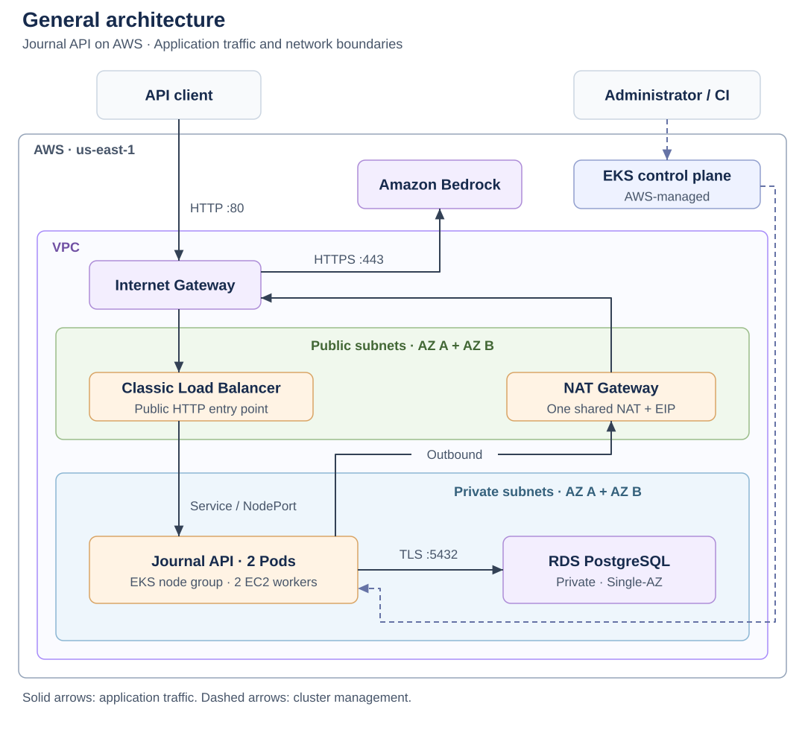
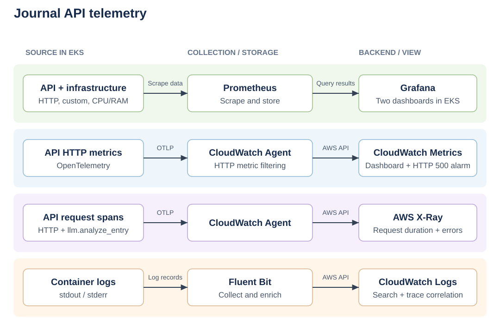
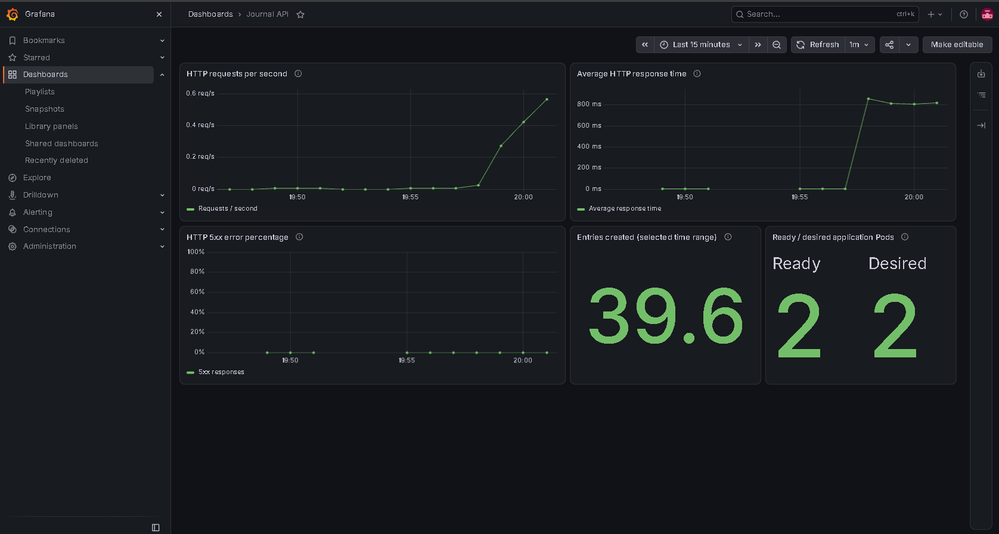
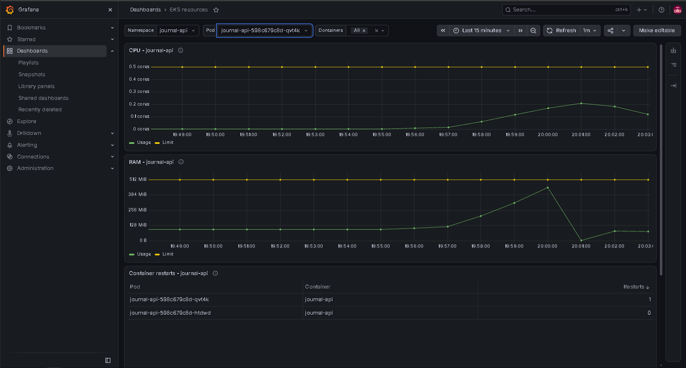
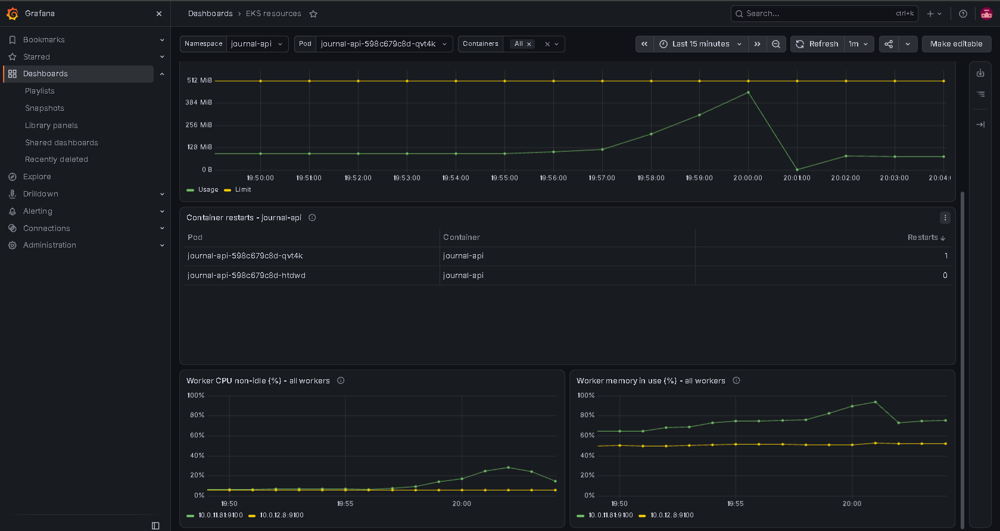
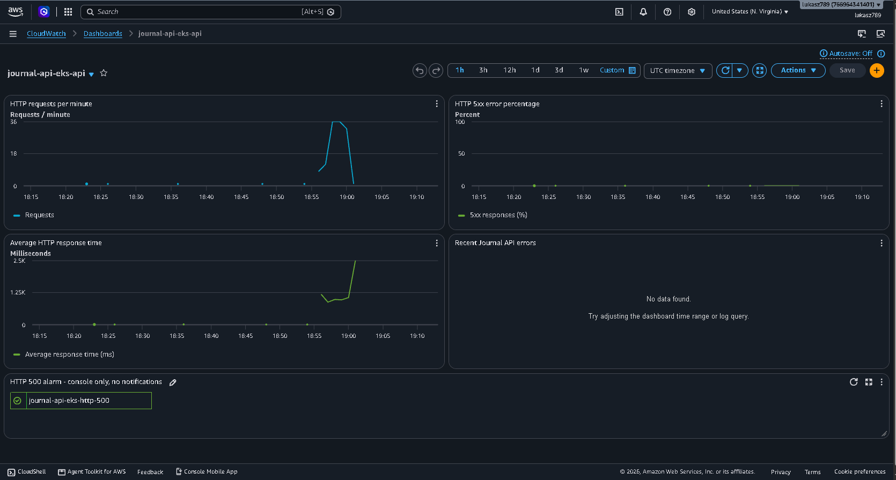
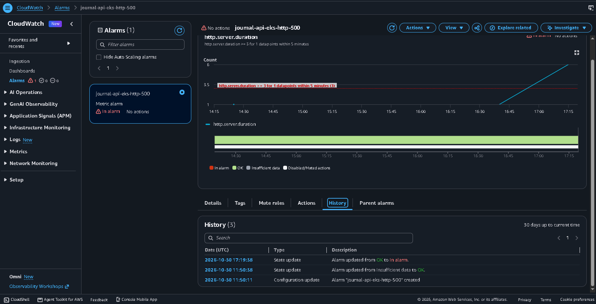
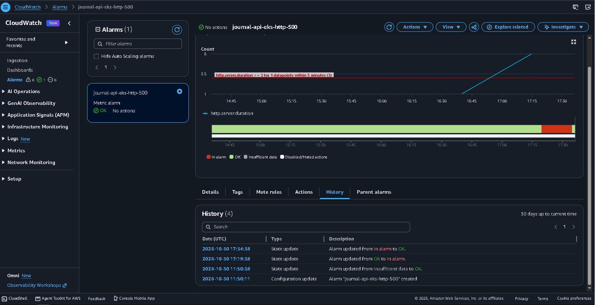
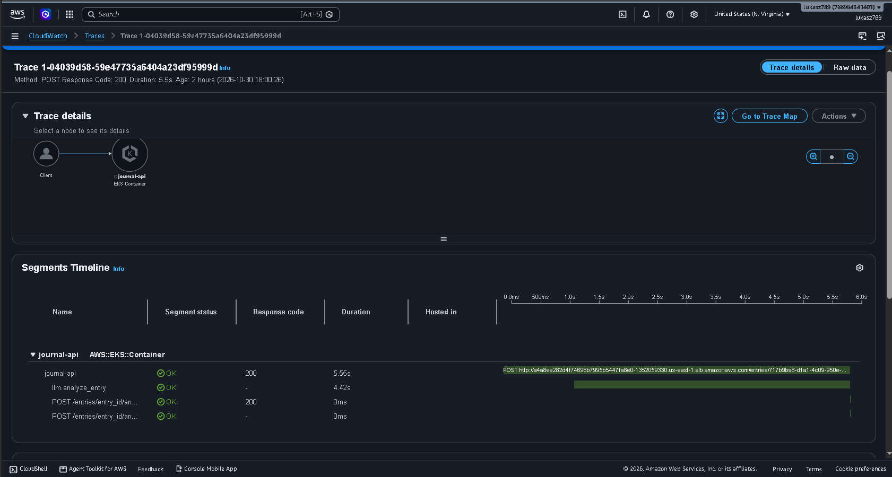

# Journal API on AWS

This project deploys a FastAPI journal application to Amazon EKS, with private RDS PostgreSQL, Terraform infrastructure, GitHub Actions delivery, and application monitoring. Journal entries support CRUD operations and AI analysis through Amazon Bedrock.

It continues my [AWS CLI two-tier infrastructure practice project](https://github.com/lukasz789/aws-cli-two-tier-infrastructure-practice): EC2 setup scripts become Terraform, the API runs in containers, and PostgreSQL moves to RDS.

> [!IMPORTANT]
> The original application comes from [learntocloud/journal-starter](https://github.com/learntocloud/journal-starter). My work here mostly covers infrastructure, containerization, delivery, and observability. See the [original README](README.original.md) and the change summary in the [Project files and changes](#project-files-and-changes) section.

## Contents

1. [Project files and changes](#project-files-and-changes)
2. [General architecture](#general-architecture)
3. [Created resources](#created-resources)
4. [CI/CD](#cicd)
5. [Deployment](#deployment)
6. [Verification](#verification)
7. [Observability](#observability)
8. [Cleanup](#cleanup)
9. [Costs](#costs)
10. [Further improvements / Known limitations](#further-improvements--known-limitations)

## Project files and changes

All files and directories created or modified for this deployment (most were created from scratch; the existing API code and supporting configuration were updated where needed).

```text
.
├── .dockerignore
├── .gitignore
├── .github/
│   └── workflows/
│       └── ci.yml
├── Dockerfile
├── README.md
├── pyproject.toml
├── uv.lock
├── api/
│   ├── main.py
│   ├── telemetry.py
│   └── services/
│       ├── entry_service.py
│       └── llm_service.py
├── infra/
├── k8s/
├── scripts/
│   ├── bootstrap.sh
│   ├── configure_github_variables.sh
│   ├── run_database_setup.sh
│   └── install_monitoring.sh
├── tests/
│   └── test_api.py
└── docs/
    ├── diagrams/
    └── images/
```

**Important files overview:**

| File | Change | Purpose / changes |
|---|---|---|
| [api/main.py](api/main.py) | **Modified** | Starts telemetry, adds `trace_id`/`span_id` to logs, and exposes `GET /health` for Kubernetes probes and CI/CD. |
| [api/telemetry.py](api/telemetry.py) | New | Configures OpenTelemetry HTTP metrics and request traces, excluding `/health`. Exposes `/metrics` on port 9464 for Prometheus and exports telemetry to CloudWatch Agent. |
| [api/services/entry_service.py](api/services/entry_service.py) | **Modified** | Adds a custom counter, incremented after each successful entry write to the database.<br>• Each API Pod keeps its own counter in RAM.<br>• `telemetry.py` exposes the metric for Prometheus to collect.<br>• The separate Grafana dashboard query sums counter increases across API Pods for the selected time range.<br>• Counts entry-creation events, not the current number of records in RDS. |
| [api/services/llm_service.py](api/services/llm_service.py) | **Modified** | Adds the custom `llm.analyze_entry` span to show the duration of the external LLM call (model from AWS Bedrock) within a request trace. |
| [infra/cloudwatch.tf](infra/cloudwatch.tf) | New | Creates the CloudWatch HTTP dashboard and an alarm (for at least 3 HTTP 500 responses in 5 minutes). The dashboard includes error logs and alarm state; notifications are disabled. |
| [infra/ecr.tf](infra/ecr.tf) | New | Creates the private ECR image repository with encryption, scan-on-push and immutable commit-SHA tags. The `latest` tag remains mutable. |
| [infra/eks-addons.tf](infra/eks-addons.tf) | New | Installs three add-ons, each running its own Pods:<br>1. **Pod Identity Agent** — runs `eks-pod-identity-agent-*` Pods in the `kube-system` namespace, one per EC2 worker. Supplies temporary IAM credentials to associated Pods; used only by the other two add-ons in this project's current configuration.<br>2. **VPC CNI** — runs dedicated `aws-node-*` networking Pods in the `kube-system` namespace, one per EC2 worker. They assign VPC IP addresses to the other Pods and manage their networking.<br>3. **CloudWatch Observability** — runs CloudWatch Agent Pods for metrics/traces and Fluent Bit Pods for container logs, one of each per EC2 worker, plus a controller/operator Pod. These run in the `amazon-cloudwatch` namespace. |
| [infra/eks.tf](infra/eks.tf) | New | Creates the EKS cluster:<br>1. **Control plane** — grants administrator access to the cluster creator; exposes the Kubernetes API inside the VPC and over the internet; supports IAM access mappings through EKS access entries or the `aws-auth` ConfigMap.<br>2. **Managed node group** — two EC2 workers in private subnets, running the application and monitoring Pods. |
| [infra/github-actions.tf](infra/github-actions.tf) | New | Creates an **IAM role for the GitHub Actions jobs** `Build and push` and `Deploy to EKS`:<br>1. **Who can assume it:** a GitHub OIDC provider and trust policy restrict access to this repository's `main` branch.<br>2. **AWS permissions:** log in to ECR, push images to this project's repository, read EKS cluster information, and retrieve RDS credentials from Secrets Manager.<br>3. **Kubernetes permissions:** an EKS access entry and edit policy allow the role to deploy/manage application resources only in the `journal-api` namespace. |
| [infra/iam.tf](infra/iam.tf) | New | Creates four IAM roles and attaches their permissions:<br>1. **EKS control plane** (assigned in `eks.tf`) — allows EKS to manage AWS resources needed by the cluster.<br>2. **EC2 workers** (assigned in `eks.tf`) — allows nodes to communicate with the control plane and pull container images from ECR.<br>3. **VPC CNI** (associated in `eks-addons.tf`) — role for the dedicated `aws-node-*` networking Pods run by the VPC CNI add-on in `kube-system`. Allows managing network interfaces and Pod IP addresses; Pod Identity grants access through ServiceAccount `aws-node`.<br>4. **CloudWatch Observability agents** (associated in `eks-addons.tf`) — used by `cloudwatch-agent-*` Pods (metrics/traces) and `fluent-bit-*` Pods (logs) in `amazon-cloudwatch`. Allows publishing metrics/logs to CloudWatch and traces to X-Ray through Pod Identity and their shared ServiceAccount `cloudwatch-agent`. |
| [infra/network.tf](infra/network.tf) | New | Creates the VPC with DNS, two public and two private subnets across two AZs, Internet Gateway, and one shared NAT Gateway with Elastic IP. Associates public routes with IGW and private routes with NAT. |
| [infra/outputs.tf](infra/outputs.tf) | New | Exposes resource identifiers to `scripts/bootstrap.sh` and its helpers. Selected outputs become GitHub variables consumed by CI/CD. |
| [infra/providers.tf](infra/providers.tf) | New | Configures the AWS provider region and default `Project`/`ManagedBy` tags. |
| [infra/rds.tf](infra/rds.tf) | New | Creates/configures:<br>1. **RDS PostgreSQL** — a private, Single-AZ database that can be placed in one of two Availability Zones.<br>• Creates the database and master user; `scripts/bootstrap.sh` creates the tables/indexes later.<br>• RDS generates and manages the master password in Secrets Manager.<br>• Uses 20 GiB of encrypted gp3 storage.<br>2. **RDS security group** — allows PostgreSQL on port 5432 only from the EKS cluster security group.<br>3. **Lab settings** — one-day backup retention; deletion protection, final snapshot and automatic minor version upgrades are disabled. |
| [infra/versions.tf](infra/versions.tf) | New | Sets required Terraform and AWS provider versions. |
| [k8s/database-setup-job.yaml](k8s/database-setup-job.yaml) | New | Temporary Job running `psql` to apply `database_setup.sql` to RDS. Launched and cleaned up by `run_database_setup.sh`; it does not run another database server. |
| [k8s/deployment.yaml](k8s/deployment.yaml) | New | Applied by CI/CD: two API replicas with the ECR commit-SHA image, health probes, CPU/RAM requests/limits, environment variables from a Secret, and telemetry endpoints. |
| [k8s/journal-api-prometheus-service.yaml](k8s/journal-api-prometheus-service.yaml) | New | Applied by CI/CD: internal `ClusterIP` Service exposing Journal API Pod metrics on port 9464. |
| [k8s/namespace.yaml](k8s/namespace.yaml) | New | Applied by `scripts/bootstrap.sh`: creates the `journal-api` namespace before the first application deployment. |
| [k8s/service.yaml](k8s/service.yaml) | New | Applied by CI/CD: public `LoadBalancer` Service, forwarding port 80 to API port 8000. Creates a Classic Load Balancer through the EKS Service controller. |
| [k8s/monitoring/journal-api-dashboard.json](k8s/monitoring/journal-api-dashboard.json) | New | Grafana application dashboard: HTTP traffic, latency, 5xx, successful entry creation and ready replicas. Loaded by `install_monitoring.sh`. |
| [k8s/monitoring/journal-api-infrastructure-dashboard.json](k8s/monitoring/journal-api-infrastructure-dashboard.json) | New | Grafana infrastructure dashboard: API container/worker CPU and RAM, resource limits and restarts. Loaded by `install_monitoring.sh`. |
| [k8s/monitoring/journal-api-prometheus-servicemonitor.yaml](k8s/monitoring/journal-api-prometheus-servicemonitor.yaml) | New | Applied by `install_monitoring.sh`: tells Prometheus to scrape `/metrics` through the API metrics Service, including HTTP and custom metrics. Cluster/node metrics use other scrape targets. |
| [k8s/monitoring/values.yaml](k8s/monitoring/values.yaml) | New | Helm settings used by `install_monitoring.sh`: monitoring resources, retention, storage, dashboards and enabled scrape targets. |
| [scripts/bootstrap.sh](scripts/bootstrap.sh) | New | Run after `terraform apply`: reads Terraform outputs, configures EKS access and waits for workers. Then uses:<br>1. `k8s/namespace.yaml` — creates the application namespace.<br>2. `scripts/run_database_setup.sh` — initializes the RDS tables/indexes.<br>3. `scripts/configure_github_variables.sh` — sets GitHub repository variables.<br>4. `scripts/install_monitoring.sh` — installs/updates monitoring and dashboards.<br>CI/CD deploys the API afterwards. |
| [scripts/configure_github_variables.sh](scripts/configure_github_variables.sh) | New | Called by `scripts/bootstrap.sh`: reads seven Terraform outputs and writes them to GitHub repository variables for CI/CD. |
| [scripts/run_database_setup.sh](scripts/run_database_setup.sh) | New | Called by `scripts/bootstrap.sh`: reads RDS credentials from Secrets Manager, creates a temporary Secret/SQL ConfigMap/Job, waits for schema setup, prints logs and cleans up. |
| [scripts/install_monitoring.sh](scripts/install_monitoring.sh) | New | Called by `scripts/bootstrap.sh`: installs/upgrades Prometheus and Grafana with Helm in `monitoring`, applies the API ServiceMonitor and loads both Grafana dashboards. |

## General architecture



### Journal API endpoints

Paths below use the public API address. `{entry_id}` is the `id` returned when creating an entry. Use `Content-Type: application/json` for request bodies.

| Endpoint | JSON request body | Success response |
|---|---|---|
| `GET /health` | None | `200` — `{"status":"healthy"}`; API process health |
| `POST /entries` | `work`, `struggle`, `intention` — all required | `201` — `detail` and the created `entry` |
| `GET /entries` | None | `200` — `entries` array and `count` |
| `GET /entries/{entry_id}` | None | `200` — the entry |
| `PATCH /entries/{entry_id}` | Any subset of `work`, `struggle`, `intention` | `200` — the updated entry |
| `DELETE /entries/{entry_id}` | None | `200` — `{"detail":"Entry deleted successfully"}` |
| `DELETE /entries` | None | `200` — `{"detail":"All entries deleted"}` |
| `POST /entries/{entry_id}/analyze` | None; analyzes the stored entry through Bedrock | `200` — `entry_id`, `sentiment`, `summary`, `topics`, `created_at` |

Entry responses contain `id`, `work`, `struggle`, `intention`, `created_at` and `updated_at`. IDs and timestamps are generated by the API.

**Create an entry (`POST /entries`):** all three fields must be strings of **1–256 characters after trimming whitespace**.

```json
{
  "work": "Deploying Journal API",
  "struggle": "Understanding EKS networking",
  "intention": "Review monitoring dashboards"
}
```

**Update an entry (`PATCH /entries/{entry_id}`):** send only the fields to change; omitted fields stay unchanged. Text values use the same length limits; PATCH fields also accept `null`.

```json
{
  "intention": "Check Prometheus targets"
}
```

Common errors: `404` for an unknown entry, `422` for invalid request bodies, and `500` when analysis fails.

**API documentation:** `GET /docs` (Swagger UI), `GET /redoc` (ReDoc) and `GET /openapi.json` (OpenAPI schema).

**Internal metrics:** `GET /metrics` is served separately on port `9464`, through `journal-api-metrics`; it is not exposed by the public API Service.

## Created resources

This inventory uses the values from `infra/terraform.tfvars.example`: `us-east-1`, two workers and two API replicas.

- One VPC using the `10.0.0.0/16` CIDR block.
- Two public and two private subnets across two Availability Zones.
- An Internet Gateway and public route table.
- One shared NAT Gateway with Elastic IP and private route table.
- One EKS cluster with an AWS-managed control plane and one managed node group: two private `t3.small` workers, each with a 20 GiB EBS root volume.
  - `journal-api` namespace (2 Pods): API replicas, public and metrics Services, and the application Secret.
  - `kube-system` namespace (8 Pods): CoreDNS, kube-proxy, VPC CNI and Pod Identity Agent.
  - `amazon-cloudwatch` namespace (5 Pods): CloudWatch Agent, Fluent Bit and their controller/operator.
  - `monitoring` namespace (6 Pods): Grafana, Prometheus, Prometheus Operator, kube-state-metrics and node-exporter; internal Services and ServiceMonitors.
  - `default` namespace: a temporary database setup Job, removed after initialization.
- Three EKS add-ons: Pod Identity Agent, VPC CNI and CloudWatch Observability.
- One public Classic Load Balancer, created from the API's `LoadBalancer` Service.
- One private, Single-AZ RDS PostgreSQL instance (`db.t4g.micro`) with 20 GiB of encrypted gp3 storage, a database and master user.
- An RDS subnet group covering both private subnets and an RDS security group allowing port 5432 from the EKS cluster security group.
- An RDS-managed Secrets Manager secret for the database credentials.
- One private ECR repository for Journal API images.
- Five IAM roles: EKS control plane, workers, VPC CNI, observability agents and GitHub Actions.
- A GitHub OIDC provider for CI/CD, plus EKS deployment access limited to the `journal-api` namespace.
- Two Pod Identity associations for the VPC CNI and observability agents.
- A CloudWatch dashboard and HTTP 500 alarm.
- Three Fluent Bit log groups under `/aws/containerinsights/<cluster_name>/`: `application`, `dataplane` and `host`.

With the example Terraform values, the deployed cluster runs **21 Pods**.

Terraform creates the AWS infrastructure; `scripts/bootstrap.sh` prepares the namespace, RDS `entries` table/indexes and monitoring; CI/CD deploys the API.

## CI/CD

The [GitHub Actions workflow](.github/workflows/ci.yml) has two paths.

### Pull request

```text
Pull request to main
    |
    | GitHub creates a temporary GITHUB_TOKEN for each job
    | Token permissions: contents: read -> checkout repository
    v
Lint + Test (parallel jobs)
    |
    | Lint: Ruff lint/format checks + Pyright
    |
    | Test:
    |   Start PostgreSQL 15 container; wait until healthy
    |   Install Python and dependencies
    |   Apply database_setup.sql (entries table + indexes)
    |   Run pytest using DATABASE_URL -> temporary test DB
    |   LLM calls are mocked; API key is a placeholder
```

### Push to main

```text
Push to main
    |
    | GitHub creates a temporary GITHUB_TOKEN for each job
    | Token permissions: contents: read -> checkout repository
    v
Lint + Test (parallel jobs)
    |
    | Lint: Ruff lint/format checks + Pyright
    |
    | Test:
    |   Start PostgreSQL 15 container; wait until healthy
    |   Install Python and dependencies
    |   Apply database_setup.sql (entries table + indexes)
    |   Run pytest using DATABASE_URL -> temporary test DB
    |   LLM calls are mocked; API key is a placeholder
    |
    | Both jobs must pass
    v
Build and push
    |
    | Request GitHub OIDC token; get temporary AWS credentials (*)
    | Build image; push to ECR with commit SHA + latest tags
    v
Deploy to EKS
    |
    | Repeat OIDC flow for fresh AWS credentials (*)
    | RDS credentials <- AWS Secrets Manager
    | Bedrock key <- GitHub Secret OPENAI_API_KEY
    | Update Secret, Deployment and Services in journal-api
    | Deploy the ECR SHA image; wait for rollout and load balancer
    | Call public /health
    v
Deployment verified
```

**(*) How the jobs get AWS access through OIDC:**

1. **Terraform prepares access:** [infra/github-actions.tf](infra/github-actions.tf) registers GitHub's OIDC provider and creates an IAM role trusted for this repository's `main` branch. The role can:

    - **Log in to ECR:** obtain a registry authentication token (`ecr:GetAuthorizationToken`).
    - **Publish images:** check existing layers, upload layers and read/write image manifests in this project's ECR repository.
    - **Read cluster information:** get this EKS cluster's API endpoint and configuration (`eks:DescribeCluster`).
    - **Read database credentials:** retrieve this project's RDS secret (`secretsmanager:GetSecretValue`).
    - **Manage Kubernetes resources:** create, update and delete resources such as Deployments, Services and Secrets in `journal-api`, authorized through an EKS access entry and `AmazonEKSEditPolicy`.

    `AWS_ROLE_ARN` identifies this role.

2. **GitHub issues a token:** `id-token: write` allows `configure-aws-credentials` to request a signed OIDC token identifying the repository and branch.
3. **AWS checks the token:** the action sends it and the role ARN to AWS STS (`AssumeRoleWithWebIdentity`). STS validates the token and the role's trust policy.
4. **The job gets temporary credentials:** later steps use the configured AWS and Kubernetes permissions. Both jobs obtain their own session of the same role.

## Deployment

Example deployment for **Linux or WSL**, using Bash. After cloning, point `origin` to your own GitHub repository. Run commands from the repository root and keep the same terminal for deployment and verification.
This creates **billable AWS resources**; the API uses public HTTP without authentication, so use disposable test data.

### 1. Tools and access

Install the following tools:

| Tool | Version |
|---|---|
| AWS CLI | 2.32.0+ (checked: 2.35.24) |
| Terraform | 1.15.x (checked: 1.15.8) |
| kubectl | 1.36.x (checked: 1.36.3) |
| Helm | 3.x (checked: 3.22.1) |
| GitHub CLI (`gh`) | No specific version required (checked: 2.46.0) |
| Git | No specific version required (checked: 2.53.0) |
| Python | 3.x (checked: 3.14.4; must be available as `python`) |
| Bash | No specific version required (checked: 5.3.9) |
| curl | 7.76.0+ (checked: 8.18.0) |
| jq | No specific version required (checked: 1.8.1) |

**AWS CLI** - check your current identity:

```bash
aws sts get-caller-identity
```

Confirm the expected AWS account and an infrastructure/EKS administrator identity. If not logged in yet:

```bash
aws login
```

**GitHub CLI** - check authentication:

```bash
gh auth status
```

If you are not signed in, log in and check again:

```bash
gh auth login
gh auth status
```

### 2. Configure Terraform and Bedrock

Create your Terraform variables file:

```bash
cp -n infra/terraform.tfvars.example infra/terraform.tfvars
```

You can use the provided example values. The main change in `infra/terraform.tfvars` is **`github_repository`**: set it to your own repository's identity.

The example uses the full OIDC format **`owner@owner_id/repository@repository_id`**, which requires both names and IDs. Get them with:

```bash
gh api 'repos/{owner}/{repo}' \
  --jq '{owner: .owner.login, owner_id: .owner.id, repository: .name, repository_id: .id}'
```

Use the returned values to build `github_repository` in the format above. Check that the pinned EKS/add-on and PostgreSQL versions are available in your selected region.

Generate a valid [Bedrock API key](https://docs.aws.amazon.com/bedrock/latest/userguide/api-keys-generate.html) in `us-east-1`, with access to `openai.gpt-oss-20b-1:0`, and store it using the interactive prompt:

```bash
gh secret set OPENAI_API_KEY
```

### 3. Create AWS infrastructure

```bash
terraform -chdir=infra init
terraform -chdir=infra fmt -check
terraform -chdir=infra validate
terraform -chdir=infra plan
terraform -chdir=infra apply
```

### 4. Bootstrap the environment

Once `terraform apply` has completed successfully and the AWS infrastructure is deployed, run:

```bash
bash scripts/bootstrap.sh
```

After the script finishes:

- `kubectl` is connected to EKS and the workers are ready.
- The `journal-api` namespace exists for the application.
- RDS has the tables and indexes needed by the API.
- GitHub repository variables are configured for CI/CD.
- Prometheus and Grafana are installed, with the project dashboards loaded.

CI/CD deploys the API in the next step.

### 5. Deploy the API through GitHub Actions

The workflow starts automatically after a push to `main`. After bootstrap, you can trigger deployment with an empty commit:

```bash
git commit --allow-empty --only -m "ci: trigger deployment"
git push --set-upstream origin main
```

Open the new run in **GitHub -> Actions**. Expect successful `Lint`, `Test`, `Build and push`, and `Deploy to EKS` jobs.

During deployment, CI/CD reads the RDS credentials, builds `DATABASE_URL` with `sslmode=require`, and creates or updates `journal-api-secrets`. AWS access uses OIDC and temporary credentials.

For later application updates, commit and push to `main` to trigger CI/CD again.

## Verification

### Infrastructure and Kubernetes resources

**Workers:**

```bash
kubectl get nodes
```

Expected: two nodes with status `Ready`.

**Journal API:**

```bash
kubectl -n journal-api get deployment journal-api
kubectl -n journal-api get services
```

Expected: Deployment `READY` is `2/2`; Service `journal-api` has type `LoadBalancer` and a public hostname. `journal-api-metrics` has type `ClusterIP` and stays internal.

**Monitoring:**

Monitoring is installed through Helm by `scripts/bootstrap.sh`. Use `helm list` to check the installation status and `kubectl` to check its Pods:

```bash
helm list --namespace monitoring
kubectl -n monitoring get pods
```

Expected: Helm status `deployed`; 6 Pods `Running`, with all containers ready.

**AWS resources:**

The table assumes the example values in `infra/terraform.tfvars`, including `aws_region = "us-east-1"` and `project_name = "journal-api-eks"`. Select that region in the AWS console. Load balancer and RDS secret names are generated automatically.

| Open in AWS console | What to check |
|---|---|
| VPC -> Your VPCs -> `journal-api-eks-vpc` -> Resource map | Two public and two private subnets across two AZs; one Internet Gateway and one NAT Gateway |
| VPC -> Route tables -> `journal-api-eks-public-rt` | Default route to the Internet Gateway |
| VPC -> Route tables -> `journal-api-eks-private-rt` | Default route to the shared NAT Gateway |
| EKS -> Clusters -> `journal-api-eks` | Cluster status `Active` |
| EKS -> Clusters -> `journal-api-eks` -> Compute -> `journal-api-eks-nodes` | Node group with two `t3.small` workers |
| EKS -> Clusters -> `journal-api-eks` -> Add-ons | Pod Identity Agent, VPC CNI and CloudWatch Observability all `Active` |
| EC2 -> Instances (workers from `journal-api-eks-nodes`) | Both workers are in private subnets, without public IPs |
| EC2 -> Load Balancers | Public Classic Load Balancer with the same hostname as Service `journal-api` |
| RDS -> Databases -> `journal-api-eks-postgresql` -> Configuration | PostgreSQL, Single-AZ, 20 GiB storage |
| RDS -> Databases -> `journal-api-eks-postgresql` -> Connectivity & security | Public access disabled; security group `journal-api-eks-rds-sg` |
| RDS -> Subnet groups -> `journal-api-eks-db-subnet-group` | Subnet IDs match `journal-api-eks-private-1` and `journal-api-eks-private-2` in VPC -> Subnets |
| EC2 -> Security Groups -> `journal-api-eks-rds-sg` -> Inbound rules | PostgreSQL port 5432 allowed only from the EKS cluster security group |
| Secrets Manager -> Secrets (secret linked from `journal-api-eks-postgresql`) | RDS-managed database credentials secret |
| ECR -> Repositories -> `journal-api-eks` -> Images | Image tagged with the deployed commit SHA and `latest` |
| IAM -> Roles -> search `journal-api-eks-` | Five project roles: control plane, workers, VPC CNI, observability and GitHub Actions |
| IAM -> Identity providers -> `token.actions.githubusercontent.com` | GitHub OIDC provider |
| EKS -> Clusters -> `journal-api-eks` -> Access entries | Role `journal-api-eks-github-actions-role` with `AmazonEKSEditPolicy` scoped to namespace `journal-api` |
| EKS -> Clusters -> `journal-api-eks` -> Access -> Pod Identity | Two role associations: `kube-system:aws-node` and `amazon-cloudwatch:cloudwatch-agent` |

### API, RDS and Bedrock

Get the public API address and check database access:

```bash
BASE_URL="http://$(kubectl -n journal-api get service journal-api \
  -o jsonpath='{.status.loadBalancer.ingress[0].hostname}')"
curl --include --fail --show-error --max-time 30 "$BASE_URL/entries"
```

Expected: HTTP 200. `/entries` reads from RDS, verifying the deployed API's database connection.

Create and read one disposable entry; keep `ENTRY_ID` for the analysis request:

```bash
ENTRY_JSON="$(curl --fail-with-body --silent --show-error --max-time 30 \
  --request POST --header 'Content-Type: application/json' \
  --data '{"work":"Deployment verification","struggle":"Learning EKS","intention":"Check the AWS setup"}' \
  "$BASE_URL/entries")"
printf '%s\n' "$ENTRY_JSON" | jq .
ENTRY_ID="$(printf '%s' "$ENTRY_JSON" | jq -er '.entry.id')"
curl --include --fail --show-error --max-time 30 "$BASE_URL/entries/$ENTRY_ID"

# A real Bedrock inference call.
curl --include --fail-with-body --show-error --max-time 120 \
  --request POST "$BASE_URL/entries/$ENTRY_ID/analyze"
```

The create endpoint returns HTTP 201 with `entry.id`; reading returns HTTP 200 with the stored entry. Analysis must return HTTP 200 with `entry_id`, `sentiment`, `summary`, `topics` and `created_at`. This checks API -> RDS -> Bedrock, beyond process health.

If analysis fails with a JSON parsing error, retry the request: model output can vary between calls and may contain invalid JSON (details in the [Further improvements / Known limitations](#further-improvements--known-limitations) section).

## Observability



**This observability setup is overkill for a small API**. A simpler AWS-based option would use CloudWatch Logs, metrics and alarms, with [Container Insights](https://docs.aws.amazon.com/AmazonCloudWatch/latest/monitoring/ContainerInsights.html) for Pod/worker metrics and X-Ray for tracing. I included Prometheus and Grafana for learning purposes; Container Insights infrastructure metrics are disabled because Prometheus already collects them.

The CloudWatch alarm triggers on at least 3 HTTP 500 responses per 5-minute evaluation period. It has no email/SMS notifications; state and history are visible in the CloudWatch console.

### Example: Journal API dashboard in Grafana

Open Grafana in a separate terminal and keep port-forward running:

```bash
kubectl -n monitoring port-forward service/monitoring-grafana 3000:80
```

Visit **http://localhost:3000**, user `admin`. In your own terminal, read the generated password (do not include it in screenshots):

```bash
kubectl -n monitoring get secret monitoring-grafana \
  -o jsonpath='{.data.admin-password}' | base64 --decode
```

Open the **Journal API** dashboard. `/health` is excluded from HTTP metrics. The custom counter can appear after the first successful insert on each API process.



HTTP metrics and **2/2 ready replicas** were visible. The entry counter is a Prometheus estimate (`increase()`), so fractional values are expected.

### Example: EKS resources dashboard in Grafana

Open the **EKS resources** dashboard to check API/container and worker CPU/RAM, restarts and resource limits.





### Example: Journal API metrics in Prometheus

To check collection directly, open Prometheus in another terminal:

```bash
kubectl -n monitoring port-forward service/monitoring-kube-prometheus-prometheus 9090:9090
```

At **http://localhost:9090**, query `up{namespace="journal-api",service="journal-api-metrics"}`. Expect one target per ready API replica, each with value `1`. No series means discovery needs checking; `0` means the scrape failed.

### Example: HTTP dashboard in CloudWatch

In the configured AWS region, open **CloudWatch -> Dashboards -> `<project_name>-api`**. After entry requests, check HTTP traffic/latency and log delivery:

```bash
AWS_REGION="$(terraform -chdir=infra output -raw aws_region)"
CLUSTER_NAME="$(terraform -chdir=infra output -raw eks_cluster_name)"
aws logs tail "/aws/containerinsights/$CLUSTER_NAME/application" \
  --region "$AWS_REGION" --since 10m --format short
```

You can also view the same logs in **CloudWatch -> Log Management -> Log Groups**: open `/aws/containerinsights/<cluster_name>/application` and select a log stream.

The log group includes multiple namespaces; filter for `journal-api` in Logs Insights.



This dashboard partly overlaps with Grafana's HTTP metrics. The duplication is intentional: this learning project uses both to practice and compare the two monitoring tools.

### Example: HTTP 500 alarm and recovery in CloudWatch

Inspect **CloudWatch -> Alarms -> `<project_name>-http-500`**, including its history. A successful deployment does not trigger this alarm. The screenshots below record a separate controlled failure/recovery test.



Temporarily pointing the LLM client at an unreachable address produced **six real HTTP 500 responses** and triggered the alarm.



After restoring Bedrock, analysis returned HTTP 200 and the alarm recovered automatically: **OK → ALARM → OK**. No manual alarm-state change was used.

Missing data counts as non-breaching, so `OK` alone does not confirm API availability.

### Example: Bedrock request trace in X-Ray

After calling `POST /entries/{id}/analyze`, open **CloudWatch -> Application Signals (APM) -> Traces** in the configured region. Select **Last 15 minutes** (or the time range covering the request), clear previous filters and run:

```text
service("journal-api") AND http.url CONTAINS "/analyze"
```

Use just `service("journal-api")` to find all API traces. Open a matching trace to see the HTTP span and nested `llm.analyze_entry`; use its `trace_id` to find correlated CloudWatch logs.



The request returned **HTTP 200** in about **5.55 s**, including a **4.42 s** LLM span. Matching `trace_id` values connect it to logs in CloudWatch Logs.

## Cleanup

Wait for any CI/CD run to finish before cleanup.

1. Delete the public API Service while EKS is still running:

   ```bash
   kubectl -n journal-api delete service journal-api
   ```

   Wait until the project's Classic Load Balancer disappears from **EC2 -> Load Balancers**.

2. Remove monitoring:

   ```bash
   kubectl -n monitoring delete servicemonitor/journal-api \
     configmap/journal-api-grafana-dashboard --ignore-not-found
   helm uninstall monitoring --namespace monitoring --wait --timeout 5m
   ```

3. In **ECR -> Repositories -> `journal-api-eks` -> Images**, delete all images. Use your repository name if you changed `project_name`. The repository must be empty for Terraform to delete it (`force_delete` is not enabled in `infra/ecr.tf`).

4. Destroy the infrastructure. **RDS data is deleted without a final snapshot.**

   ```bash
   terraform -chdir=infra destroy
   ```

5. In **CloudWatch -> Log Management -> Log Groups**, delete the project's `application`, `dataplane` and `host` log groups under `/aws/containerinsights/<cluster_name>/`. Terraform does not manage these log groups.

6. If created only for this lab, [delete the long-term Bedrock API key](https://docs.aws.amazon.com/bedrock/latest/userguide/api-keys-revoke.html) in **Amazon Bedrock -> API keys**, then delete its dedicated IAM user in **IAM -> Users**. Terraform does not manage either.

## Costs

Checked on **6 November 2026**, using `infra/terraform.tfvars.example`: `us-east-1`, Linux On-Demand workers, standard EKS support and **24 hours/day (720 hours/30 days)**. Prices are in USD and exclude tax, AWS Free Tier benefits and credits.

Base rates used in the estimates are shown in parentheses; billing units appear below each component. `GB-month` charges depend on storage size and duration; they do not require keeping the storage for a full month.

| Component | Per day (base) | Per 30 days (base) | Additional usage-dependent charges |
|---|---:|---:|---|
| [EKS control plane](https://aws.amazon.com/eks/pricing/) — standard support (`$0.10/cluster-hour`);<br>**Billed:** per cluster-hour | `$2.40` | `$72.00` | — |
| [EC2 workers](https://aws.amazon.com/ec2/pricing/on-demand/) — 2 × `t3.small`, On-Demand (`$0.0208/instance-hour`);<br>**Billed:** per second (60-second minimum) | `$1.00` | `$29.95` | Surplus CPU credits in Unlimited mode: `$0.05/vCPU-hour` |
| [EBS root volumes](https://aws.amazon.com/ebs/pricing/) — 2 × 20 GiB gp3 (`$0.08/GB-month`);<br>**Billed:** per second (60-second minimum) | `$0.11` | `$3.20` | — |
| [NAT Gateway](https://aws.amazon.com/vpc/pricing/) — 1 (`$0.045/hour`);<br>**Billed:** per hour (rounded up) + GB processed | `$1.08` | `$32.40` | `$0.045/GB` processed |
| [Classic Load Balancer](https://aws.amazon.com/elasticloadbalancing/pricing/) — 1 (`$0.025/hour`);<br>**Billed:** per hour (rounded up) + GB processed | `$0.60` | `$18.00` | `$0.008/GB` processed |
| [Public IPv4](https://aws.amazon.com/vpc/pricing/) — assume 3 addresses: 1 for NAT Gateway + 2 for one load balancer (`$0.005/address-hour`);<br>**Billed:** per second (60-second minimum) | `$0.36` | `$10.80` | — |
| [RDS PostgreSQL](https://aws.amazon.com/rds/postgresql/pricing/) — Single-AZ `db.t4g.micro`, On-Demand (`$0.016/instance-hour`);<br>**Billed:** per second (10-minute minimum after create/start/class change) | `$0.38` | `$11.52` | Surplus CPU credits: `$0.075/vCPU-hour` |
| [RDS gp3 storage](https://aws.amazon.com/rds/postgresql/pricing/) — 20 GiB (`$0.115` per GB per month);<br>**Billed:** per second (10-minute minimum), based on allocated GB | `$0.08` | `$2.30` | — |
| [Secrets Manager](https://aws.amazon.com/secrets-manager/pricing/) — 1 RDS secret (`$0.40/secret-month`);<br>**Billed:** per secret-month (prorated hourly) + API calls | `$0.01` | `$0.40` | `$0.05/10,000` API calls |
| [CloudWatch dashboard](https://aws.amazon.com/cloudwatch/pricing/) — 1 (`$3.00/dashboard-month`);<br>**Billed:** per dashboard-month (prorated hourly) | `$0.10` | `$3.00` | — |
| [CloudWatch alarm](https://aws.amazon.com/cloudwatch/pricing/) — 1 standard-resolution metric (`$0.10/metric-month`);<br>**Billed:** per alarm-month (prorated hourly) | `$0.003` | `$0.10` | — |
| [ECR images](https://aws.amazon.com/ecr/pricing/);<br>**Billed:** GB-month stored (prorated hourly) | — | — | `$0.10/GB-month` stored |
| [CloudWatch custom metrics](https://aws.amazon.com/cloudwatch/pricing/) — 1 custom metric name: `http.server.duration` in `JournalAPI`;<br>**Billed:** separately for each reported HTTP status code (prorated hourly) + `PutMetricData` requests | — | — | `$0.30/month` per reported HTTP status code + `$0.01/1,000` `PutMetricData` requests (sending metrics to CloudWatch Metrics) |
| [CloudWatch Logs](https://aws.amazon.com/cloudwatch/pricing/);<br>**Billed:** GB ingested/scanned + GB-month stored (prorated hourly) | — | — | `$0.50/GB` ingested (logs sent to CloudWatch) + `$0.03/GB-month` stored (compressed logs kept) + `$0.005/GB` scanned (logs searched by Logs Insights; each query is charged for the data it scans) |
| [X-Ray traces](https://aws.amazon.com/cloudwatch/pricing/);<br>**Billed:** per trace recorded/retrieved/scanned | — | — | `$5/million` recorded (traces saved) + `$0.50/million` retrieved (full trace details fetched) + `$0.50/million` scanned (traces searched by queries) |
| [Bedrock](https://aws.amazon.com/bedrock/pricing/) — OpenAI `gpt-oss-20b`, Standard On-Demand;<br>**Billed:** per input/output token | — | — | `$0.07/million` input tokens + `$0.30/million` output tokens |
| [RDS backups](https://aws.amazon.com/rds/postgresql/pricing/) — automated backups retained for 1 day;<br>**Billed:** GB-month stored (prorated daily) | — | — | Up to 20 GiB included in this setup (allowance = total allocated RDS storage per account/region); `$0.095/GB-month` above that |
| [Data transfer](https://aws.amazon.com/ec2/pricing/on-demand/);<br>**Billed:** per GB transferred | — | — | Internet egress: `$0.09/GB` for the first 10 TB/month; cross-AZ: `$0.01/GB` worker ↔ RDS or NAT, `$0.02/GB` total worker ↔ worker |
| [AWS KMS](https://aws.amazon.com/kms/pricing/);<br>**Billed:** per API request | — | — | `$0.03/10,000` encryption requests (e.g. when creating an encrypted database or restoring a backup — very low usage expected in this lab); there is no monthly fee for AWS-managed keys |
| **Base total** | **`~$6.12`** | **`~$183.67`** | **Plus usage-dependent charges above** |

## Further improvements / Known limitations

- Restrict API access and add HTTPS, authentication/authorization and rate limits. The API currently uses public HTTP without authentication; `POST /entries/{id}/analyze` triggers paid Bedrock inference, creating a risk of abuse and unexpected costs.
- Each API request that uses the database currently creates a new connection pool (closed after the request finishes) using `asyncpg` (the Python library for PostgreSQL), opening 10 connections by default. This adds memory overhead and can cause rapid RAM spikes when requests overlap.
  TODO: Create one small, bounded pool per API process at startup and use it across requests.
- RDS automatically changes the master password every 7 days by default. The API gets its password during deployment and keeps using that copy, so it can lose database access after rotation.

  a) TODO: Update the Kubernetes Secret from Secrets Manager and restart the API Pods automatically when the password changes.

  b) BETTER SOLUTION (for a larger setup): Use [IAM DB authentication](https://docs.aws.amazon.com/AmazonRDS/latest/UserGuide/UsingWithRDS.IAMDBAuth.html) with short-lived tokens instead of a stored API database password. Assign an IAM role to API Pods and generate fresh tokens for new connections. This needs 300–1000 MiB of extra RAM on RDS, so consider a larger DB instance than the current `db.t4g.micro` (1 GiB).
- The API currently connects to PostgreSQL using the RDS master account, which has administrative privileges.
  TODO: Create a separate database user for the API with only `SELECT`, `INSERT`, `UPDATE` and `DELETE` access to the `entries` table. Keep the master account for administration and database setup.
- Enable RDS deletion protection, create a final snapshot before deletion, extend backup retention beyond 1 day.
- Improve `POST /entries/{id}/analyze` reliability: malformed model JSON can cause HTTP 500. Use [provider-enforced structured outputs](https://docs.aws.amazon.com/bedrock/latest/userguide/structured-output.html) with a compatible model and API (such as Converse); define a schema for `sentiment`, `summary` and `topics`, and handle incomplete responses.
- Add persistent storage for Prometheus metrics and Grafana data so they survive Pod recreation.
- The HTTP 500 alarm currently has no email/SMS notifications. TODO: Add notifications through Amazon SNS.
- Terraform state is currently stored locally in `infra/terraform.tfstate`. TODO: Move it to a private, encrypted S3 backend with versioning and S3 state locking (`use_lockfile = true`). This would let different computers and future CI/CD runs share the same state. Versioning allows recovery of earlier state versions; locking prevents concurrent Terraform operations from modifying the same state.
- Improve availability with RDS Multi-AZ (currently Single-AZ) and configure `topologySpreadConstraints` to spread API Pods evenly across workers/AZs (currently both API replicas can run on the same worker).
- Improve outbound network availability; both AZs currently share one NAT Gateway.
- Add Pod autoscaling with HPA to adjust Journal API replicas based on metrics.
- Add worker autoscaling with Cluster Autoscaler; consider Karpenter for dynamic node provisioning, or [EKS Auto Mode](https://docs.aws.amazon.com/eks/latest/userguide/automode.html) for autoscaling based on Karpenter and broader infrastructure management by AWS.
- Use VPC endpoints for private access to Bedrock, ECR, CloudWatch and X-Ray instead of public endpoints through NAT.
- Automate `scripts/bootstrap.sh` and monitoring updates in a separate CI/CD workflow after EKS is created; both are currently run manually.
- Extend project tagging to EKS worker instances, EBS volumes, the Kubernetes-created load balancer and CloudWatch log groups, making resource identification and cost tracking more consistent.
